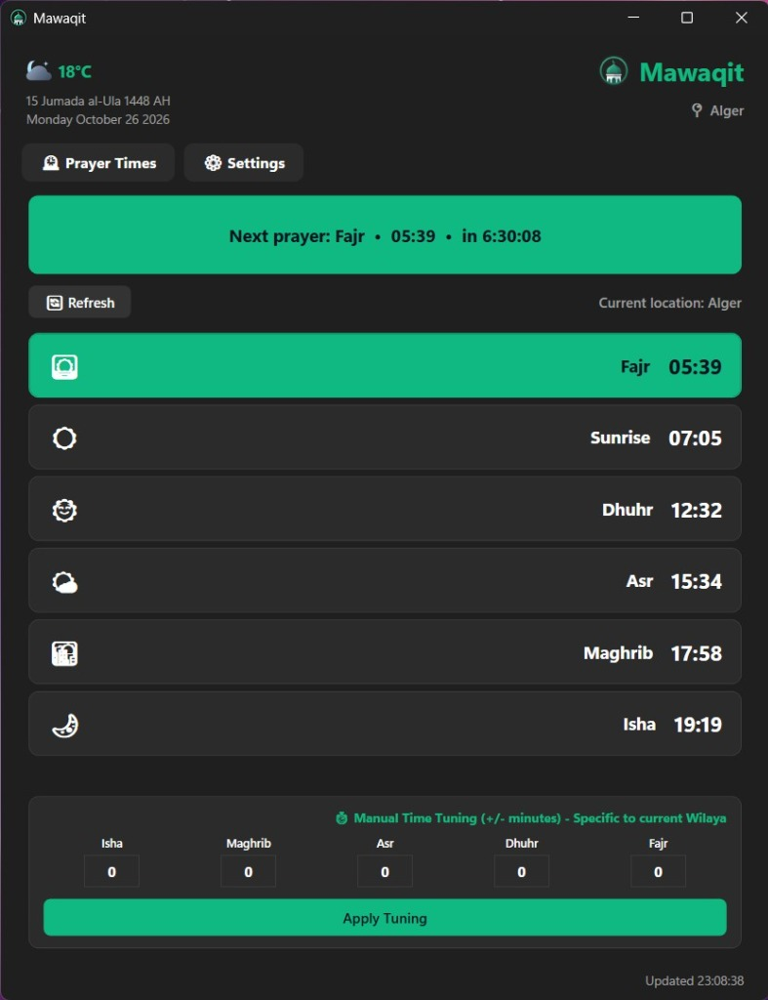
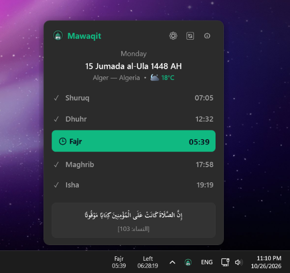
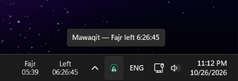
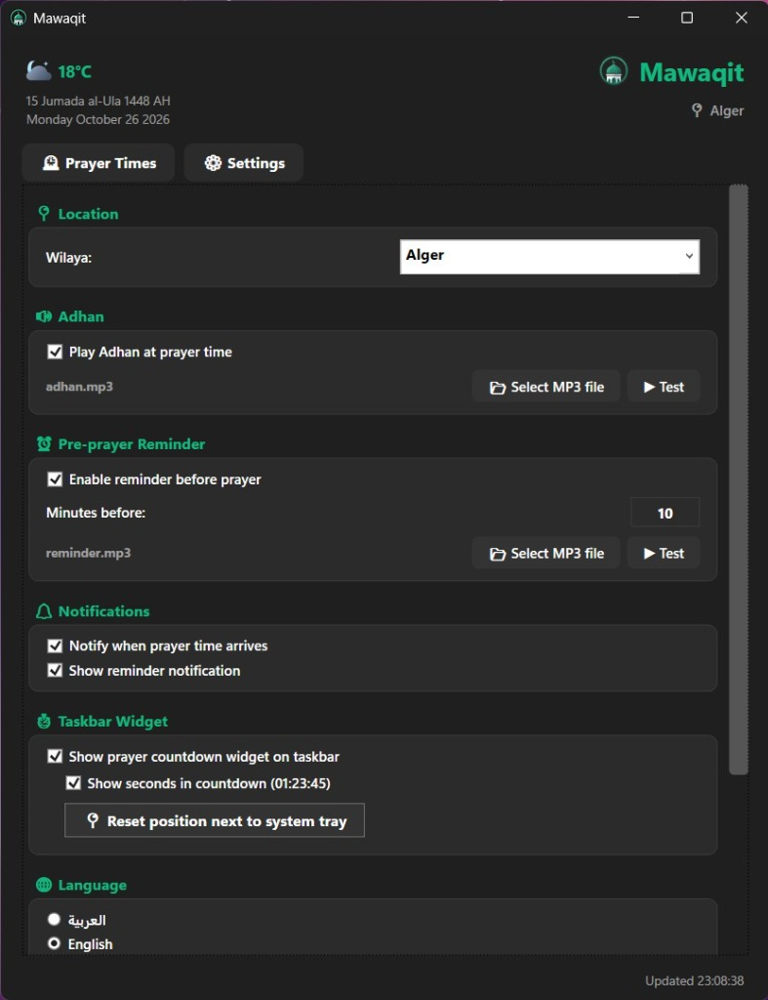
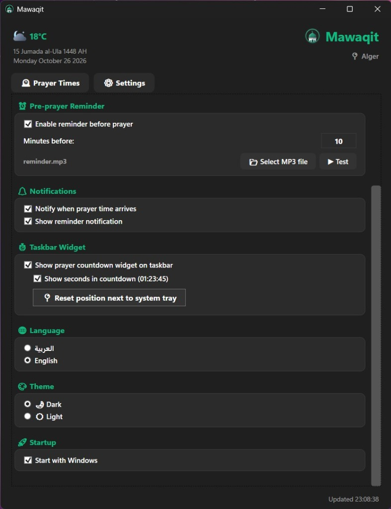

<p align="center">
  
</p>

<h1 align="center">Mawaqit (مواقيت الصلاة) - C# / .NET 8 WPF Edition</h1>

<p align="center">
  <b>A modern, high-performance Windows desktop application for Islamic prayer times in Algeria</b><br>
  Built with <b>C# (.NET 8 WPF)</b> • Windows 11 Fluent Design & Mica • Real-time Taskbar Countdown Widget • Adhan Audio & Notifications
</p>

<p align="center">
  
  
  
  
  
</p>

---

> [!IMPORTANT]
> **🇩🇿 Algeria Only / يعمل في الجزائر فقط:**
> - **English:** This application is designed to work **only in Algeria**. Prayer times are calculated exclusively according to the official calculation method of the **Algerian Ministry of Religious Affairs (وزارة الشؤون الدينية والأوقاف)** and covers all 69 Algerian wilayas and for cities outside the states, you can make manual adjustments based on the state nearest to you.
> - **العربية:** هذا التطبيق مخصص للعمل **في الجزائر فقط**، ويغطي مواقيت الصلاة لجميع ولايات الجزائر الـ 69 بالنسبة للدوائر والبلديات خارج الولايات يمكن إجراء تعديلات يدوية استناداً إلى الولاية الأقرب إليك.###### تُحسَب مواقيت الصلاة وفقاً لطريقة الحساب الرسمية المعتمدة لدى وزارة وزارة الشؤون الدينية والأوقاف الجزائرية.

A high-performance, modern Windows desktop application for Islamic prayer times in Algeria, remade in **C# (.NET 8 WPF)** from the original Python/Tkinter application.

---

## 📸 Application Showcase

### 🖥️ Main Dashboard & Quick Glance Flyout
The main application dashboard provides an elegant view of all daily prayer times with live countdown to the next prayer, active prayer highlighting, weather integration, and per-wilaya manual calibration. The quick taskbar flyout opens instantly from the tray with completed prayer checkmarks and Quranic verse.

<p align="center">
  
  &nbsp;
  
</p>

### ⏱️ Real-Time Taskbar Countdown Widget
A dedicated, borderless Fluent widget sitting directly on your Windows taskbar next to the notification area. Always know how much time is left until the next prayer at a glance, with seconds precision, elapsed indicators, and seamless tray docking.

<p align="center">
  
</p>

### ⚙️ Rich Customization & Settings
Tailor every aspect of the application: select from all 58 Algerian Wilayas, pick and test custom Adhan & Pre-prayer reminder `.mp3` audio files, customize notification timing, toggle taskbar widget options, switch between Dark/Light themes, and enable Windows auto-start.

<p align="center">
  
  &nbsp;
  
</p>

---

## 🌟 Key Features & Improvements

1. **Native Windows Typography & DirectWrite BiDi Rendering**:
   - Unlike Tkinter which required reversing Arabic words manually, WPF natively uses DirectWrite / Uniscribe and HarfBuzz text shaping.
   - Arabic characters connect smoothly and correctly with full cursive ligatures and native `FlowDirection="RightToLeft"` layout.
2. **Windows 11 Fluent Design & Mica / Glass**:
   - Native integration with Windows 11 Desktop Window Manager (DWM) for rounded corners (`DWMWCP_ROUND`), immersive dark mode (`DWMWA_USE_IMMERSIVE_DARK_MODE`), and system backdrops (`DWMWA_SYSTEMBACKDROP_TYPE`).
   - Emerald green accent (`#10B981`) highlighting the next prayer card with active live countdown.
3. **Official Algerian Calculation Method**:
   - Algerian Ministry of Religious Affairs (AlAdhan API method 19).
   - Friday rule: On Friday, Dhuhr is automatically displayed as **Jumu'ah** (الجمعة).
4. **All 69 Algerian Wilayas & Communes**:
   - Includes all 58 wilayas + major communes (Barika, Aflou, El Kantara, Bir El Ater, Bou Saada, etc.).
   - Smart search and diacritic-insensitive filtering for Arabic and French/English names.
5. **Manual Time Tuning per Wilaya**:
   - Adjust +/- 60 minutes for Fajr, Dhuhr, Asr, Maghrib, and Isha directly on the Prayer Times tab.
   - Changes are saved per wilaya in `%APPDATA%\Mawaqit\config.json` and immediately update the countdown and cards.
6. **Custom Audio & Notifications**:
   - Play Adhan at exact prayer time.
   - Pre-prayer reminder (1–60 minutes before Adhan).
   - Custom floating Toast Notifications (with auto-dismiss or stay open during Adhan).
   - Audio file picker with interactive **Test (▶) / Stop (⏹)** toggle.
   - Self-healing audio path resolver that locates MP3s across AppData, application folders, or user paths.
7. **Taskbar Timer Countdown Widget (Awqat Salaat Style)**:
   - Dedicated, borderless Fluent widget directly on the Windows Taskbar showing real-time ticking countdown to the next prayer.
   - Sits docked seamlessly beside the system tray (with DPI awareness for 100%–200% scaling).
   - Can be freely dragged across the taskbar or desktop with auto-saved custom coordinates.
   - Shows prayer icon, name, prayer time, and countdown (`-01:23:45`).
   - During active prayer / Adhan window (0–20 mins), displays an elapsed indicator (`+00:04:12`) with pulsing amber/emerald badge.
   - Left-click toggles the main window; right-click context menu provides quick controls (Dock next to tray, toggle seconds, toggle prayer time, compact view, Settings, hide).
8. **Fluent / Mica Taskbar Flyout**:
   - One-click popup directly from the tray with next prayer highlight, completed prayers checkmarks, current weather, and daily Quranic verse.
9. **System Tray Integration**:
   - Lives in the system notification tray with live tooltip: `Mawaqit — Fajr left 6:26:45`.
   - Context Menu: Show App, Live Countdown, Volume submenu (0%, 25%, 50%, 75%, 100%, Custom slider), Mute/Unmute, About dialog with Quranic verse, and Exit.
10. **Single Instance Guard & IPC**:
    - Named Win32 Mutex `Global\Mawaqit_SingleInstance_Mutex_v4` and Event `Global\Mawaqit_ShowEvent_v4`.
    - When a second instance launches, it signals the existing instance to bring its window to the foreground and exits immediately with code 0.
11. **Weather & Live Temperature**:
    - Live temperature from Open-Meteo API for the selected Wilaya's coordinates, updated every 45 minutes with color coding (<5°C, <15°C, <25°C, <35°C, >=35°C).
12. **Gregorian & Hijri Calendars**:
    - Dual calendar display using `System.Globalization.UmAlQuraCalendar`.

---

## 🚀 Command-Line Flags

| Flag | Description |
|---|---|
| `--startup` | Launches silently minimized to the Windows system tray. |
| `--uninstall` | Terminates running instances and removes registry keys (`HKCU\Software\Microsoft\Windows\CurrentVersion\Run`). |
| `--enable-startup` | Enables Windows auto-start in registry. |
| `--disable-startup` | Disables Windows auto-start in registry. |

---

## 🛠️ Project Architecture

```
Mawaqit/
├── Mawaqit.csproj                    # Project file (net8.0-windows, WPF + NotifyIcon)
├── App.xaml / App.xaml.cs            # Entry point, single-instance guard, CLI handling
├── MainWindow.xaml / .xaml.cs        # Main dashboard, tabs, prayer cards, countdown, tuning
├── GlobalUsings.cs                   # Clean global namespaces
├── screenshots/                      # Application preview screenshots
│   ├── main_dashboard.jpg            # Main prayer dashboard & tuning view
│   ├── taskbar_flyout.png            # Fluent / Mica taskbar quick flyout
│   ├── taskbar_widget.png            # Windows taskbar live countdown widget
│   ├── settings_audio_notifications.jpg # Audio & notification settings
│   └── settings_theme_startup.jpg    # Theme, language & startup settings
├── Models/
│   ├── Wilaya.cs                     # 69 Algerian locations with coordinates & search filter
│   ├── PrayerTimes.cs                # Prayer models, order, and icons
│   ├── AppConfig.cs                  # JSON configuration schema & persistence
│   └── ThemeColors.cs                # Dark & Light palettes (#10B981 emerald accent)
├── Services/
│   ├── Logger.cs                     # startup.log and error.log logger
│   ├── SingleInstanceService.cs      # Win32 Mutex & ShowEvent IPC
│   ├── RegistryService.cs            # Windows Startup registry manager
│   ├── LocalizationService.cs        # Arabic & English text resources
│   ├── HijriDateService.cs           # UmAlQura calendar conversion
│   ├── WeatherService.cs             # Open-Meteo temperature API
│   ├── PrayerTimesService.cs         # AlAdhan API, tuning & offline caching
│   ├── AudioService.cs               # WPF MediaPlayer audio manager
│   ├── TrayService.cs                # System tray icon, context menu & volume popups
│   └── DwmHelper.cs                  # Windows 11 DWM glass & dark mode styling
├── Controls/
│   ├── AboutWindow.xaml / .cs        # Quranic verse [An-Nisa: 103] & author modal
│   ├── TaskbarFlyoutWindow.xaml / .cs# Fluent taskbar quick glance flyout
│   ├── TaskbarWidgetWindow.xaml / .cs# Taskbar timer countdown widget (Awqat Salaat WinUI style)
│   ├── ToastNotificationWindow.xaml  # Floating corner toast notification
│   └── VolumePopupWindow.xaml       # Slim tray volume slider
└── Resources/
    ├── logo.ico                      # Application icon
    ├── logo.png                      # Application logo
    └── Media/
        ├── adhan.mp3                 # Adhan audio file
        └── reminder.mp3              # Pre-prayer reminder audio file
```

---

## 🔨 How to Build and Run

### Run from Source:
```powershell
dotnet run --project C:\Users\1\.gemini\antigravity-ide\scratch\Mawaqit
```

### Publish Single-File Executable:
```powershell
dotnet publish -c Release -r win-x64 --self-contained false -p:PublishSingleFile=true -o C:\Users\1\.gemini\antigravity-ide\scratch\Mawaqit\publish
```

The resulting standalone executable is located at:
`C:\Users\1\.gemini\antigravity-ide\scratch\Mawaqit\publish\Mawaqit.exe`

### Build Installer (Setup.exe):

You can build the installer with one command or double-click:

1. **One-Click Build (Batch File)**:
   Double-click `build_installer.bat` in the project root.

2. **PowerShell Script**:
   ```powershell
   # Standard lightweight installer (~6 MB, requires .NET 8 Desktop Runtime)
   .\build_installer.ps1

   # Standalone installer (~67 MB, includes .NET 8 runtime, works on any PC)
   .\build_installer.ps1 -Standalone

   # Build both installers at once
   .\build_installer.ps1 -Both
   ```

3. **Direct Inno Setup Compiler**:
   ```powershell
   & "C:\Program Files\Inno Setup 7\ISCC.exe" "MawaqitSetup.iss"
   ```

The compiled installers are saved in:
- `installer_output\Mawaqit-2.0.0-Setup.exe` (Standard)
- `installer_output\Mawaqit-2.0.0-Standalone-Setup.exe` (Standalone)
